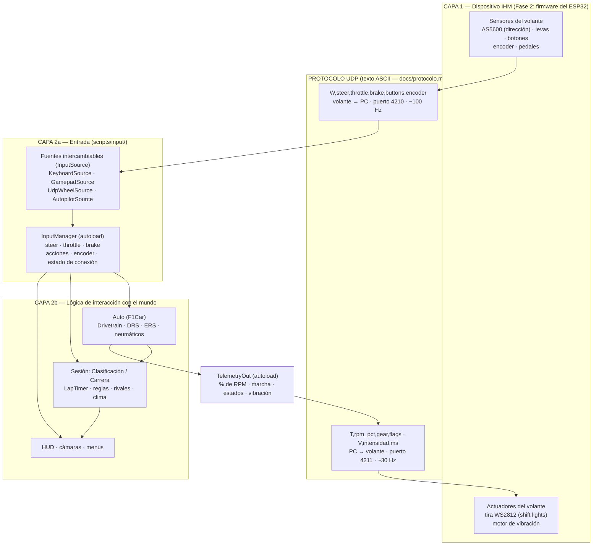

# Simulador F1 — Fase 1 (software)

Trabajo Práctico Integrador de **Realidad Virtual** (Ingeniería Mecatrónica, UNCuyo): un
**Sistema de Realidad Mixta** formado por un mundo virtual 3D y un dispositivo de interacción
hombre-máquina (IHM) propio.

- **Mundo virtual (este repositorio):** simulador de un monoplaza tipo Fórmula 1 en **Godot 4.7**
  (GDScript, física **Jolt**, renderer Forward+), construido con primitivas 3D.
- **Dispositivo IHM (Fase 2, todavía no construido):** volante casero con ESP32 que se comunica
  con el juego por **UDP**. El juego ya trae implementado y probado el lado PC de ese protocolo.

Autor: Tomás García Sad.

---

## 1. Cómo abrirlo y ejecutarlo

1. Abrir **Godot 4.7** → *Importar* → elegir `project.godot` de esta carpeta.
   La primera vez Godot importa los recursos y crea la carpeta `.godot/` (no se versiona).
2. Presionar **F5** (Ejecutar proyecto). Arranca en el menú principal.
3. Elegir **Nivel 1 — Clasificación** o **Nivel 2 — Carrera** y preparar la sesión:

```
Nivel  →  Circuito  →  Clima  →  (Carrera: vueltas)  →  Neumático de salida  →  Empezar
```

   En esa pantalla, **↑ ↓** pasa de una opción a otra y **← →** cambia el valor (con el volante:
   encoder y levas; **DRS** acepta, **Reset** vuelve). A la derecha se ve el trazado del circuito con
   la largada y el sentido de marcha, su país, su longitud y los mejores tiempos para ese clima.
   La última selección queda guardada.

No hace falta instalar nada más para jugar con teclado o gamepad.
Las herramientas de `tools/` (volante simulado y puente serie) necesitan Python 3.10+:
ver [`tools/README.md`](tools/README.md).

## 2. Controles

Todo el juego se maneja a través del `InputManager`; estas son las teclas de la fuente **Teclado**
(`scripts/input/keyboard_source.gd`) y los botones de la fuente **Gamepad**.

| Acción | Teclado | Gamepad (tipo Xbox) | Volante (bit del protocolo) |
|---|---|---|---|
| Dirección | A / D o ← / → | Stick izquierdo | `steer` |
| Acelerador | W o ↑ | Gatillo derecho | `throttle` |
| Freno | S o ↓ | Gatillo izquierdo | `brake` |
| Subir marcha | E | RB | bit 0 |
| Bajar marcha | Q | LB | bit 1 |
| DRS (abrir/cerrar) | F | Y | bit 2 |
| ERS (mantener apretado) | Espacio | A | bit 3 |
| Limitador de boxes | L | X | bit 4 |
| Volver a pista | R | Back / Select | bit 5 |
| Cambiar cámara | C | B | bit 6 |
| Pausa | Esc o P | Start | bit 7 |
| Piloto automático: ceder / retomar el control | T | R3 (clic del stick derecho) | — |
| Reparto de frenos (+ / −) | Re Pág / Av Pág | Cruceta ↑ / ↓ | encoder |

Notas:

- **Teclado y gamepad siempre escuchan** pausa (Esc/P), volver a pista (R) y cámara (C), aunque la
  fuente activa sea el piloto automático o el volante.
- **Piloto automático:** **T** se lo cede o lo retoma en cualquier momento de la sesión. Además, con
  el piloto automático manejando, tocar la dirección o un pedal (teclado o gamepad) devuelve el
  control al jugador. El cambio queda en la opción *Fuente de entrada* en memoria (no se guarda en
  disco hasta que se guarden las opciones).
- La caja es **automática por defecto**. Para usar las levas: *Opciones → Caja de cambios → apagar "Automática"*.
- Con caja automática, la **marcha atrás** entra sola al mantener el freno con el auto detenido.
  En manual: bajar de 1ª a N y de N a R con el auto detenido.
- **En boxes**, mientras cambian los neumáticos, las levas (E / Q) o el botón DRS (F) eligen el
  compuesto que se monta.
- **Ayuda de dirección:** con teclado, apretar la tecla a fondo gira "todo lo que el agarre permite"
  a esa velocidad (no más). Con gamepad y volante está apagada. Se cambia en
  *Opciones → Ayuda de dirección* (Automática / Siempre / Nunca).
- En los menús, con el volante: el **encoder** mueve el foco, las **levas** cambian valores,
  **DRS** acepta y **Reset** vuelve atrás.

## 3. Qué tiene el juego

| | Nivel 1 — Clasificación | Nivel 2 — Carrera |
|---|---|---|
| Objetivo | Mejor vuelta posible | Ganar a N vueltas (configurable, 3 por defecto) |
| Circuito | Cualquiera de los **25** (24 del calendario 2026 + Los Aromos) | Ídem |
| Clima | **Seco, Lluvia o Variable**, a elección | Ídem |
| Otros autos | **Fantasma** de tu mejor vuelta, uno por circuito y clima (`user://fantasmas/`) | 4 rivales con IA (línea de carrera, desgaste, neumático según el clima; dificultad en *Opciones*) |
| Reglas | Vuelta inválida si cortás la pista | Largada con semáforo, **parada en boxes obligatoria**, penalizaciones |
| Fin | Menú de pausa → *Terminar y ver resultados* | Bandera a cuadros → tabla de resultados |

Común a los dos niveles:

- **Auto**: `VehicleBody3D` + 4 `VehicleWheel3D`, modelado solo con primitivas (cajas, cilindros,
  cono, esfera y toro). Puesta a punto en un recurso editable (`assets/setups/car_setup_default.tres`).
- **Física de F1** (Fase 1c): carga aerodinámica realista (2 veces el peso del auto a 250 km/h),
  sensibilidad del neumático a la carga, suspensión y frenos acordes. Medido en el skidpad:
  2,1 g en curvas lentas, 4,6 g a 234 km/h y 5,1 g a 270 km/h; frena de 300 a 100 km/h en 71 m.
  Ver [`docs/skidpad.md`](docs/skidpad.md).
- **Motor y caja**: RPM derivadas de la velocidad de las ruedas y la relación de marcha, curva de
  par, 8 marchas, limitador de régimen, caja manual o automática, sonido de motor por síntesis.
- **25 circuitos**: el original "Autódromo Los Aromos" (2951 m) y los **24 del calendario 2026**
  con su trazado real en planta, longitud oficial y sentido de giro (Melbourne, Shanghái, Suzuka,
  Sakhir, Yeda, Miami, Montreal, Mónaco, Barcelona, Spielberg, Silverstone, Spa, Hungaroring,
  Zandvoort, Monza, Madrid, Bakú, Singapur, Austin, México, Interlagos, Las Vegas, Lusail y
  Yas Marina). Cada uno se genera desde un recurso (`assets/circuits/<id>.tres`) con `Path3D` y
  `CSGPolygon3D`: asfalto, pianos, muros, boxes, DRS, sectores, grilla y decorado.
  Detalle y aproximaciones en [`docs/circuitos.md`](docs/circuitos.md).
- **Clima**: seco, lluvia o variable. El agua en pista cambia el aspecto del asfalto, el agarre y
  el ritmo de los rivales; con lluvia los autos levantan **spray**.
- **Neumáticos**: blando, medio, duro, intermedio y lluvia extrema; se eligen al salir y se cambian
  en boxes. El desgaste tiene meseta y "acantilado" y es proporcional a la carrera, así que **hay
  estrategia**: blando para tandas cortas, medio para media carrera, duro para tandas largas. **Aquaplaning** por rueda según velocidad, agua, compuesto y desgaste, con aviso en el
  HUD y vibración. Fórmula y tabla en [`docs/neumaticos_y_aquaplaning.md`](docs/neumaticos_y_aquaplaning.md).
- **Mejores tiempos**: los 5 mejores por circuito y clima (se ven en el menú).
- **Cronometraje**: 3 sectores con `Area3D`, vuelta actual / última / mejor, delta en vivo,
  invalidación por límites de pista.
- **Mecánicas F1**: DRS (solo en zonas, se cierra al frenar), ERS (se carga frenando, se gasta con
  el botón), desgaste de neumáticos (se renuevan en boxes), limitador de boxes (80 km/h).
- **Cámaras**: persecución, onboard y T-cam.
- **HUD**: velocidad, marcha, RPM con **shift lights** (los mismos 10 LEDs que tendrá la tira
  física), tiempos, sectores, delta, ERS, DRS, limitador, pedales, neumáticos (compuesto y desgaste),
  circuito, clima y agua en pista, aviso de aquaplaning, reparto de frenos,
  minimapa, estado de conexión del dispositivo.
- **Menús**: principal, **preparar sesión** (circuito, clima, vueltas, neumático), opciones (fuente de entrada, sensibilidad, curva, zona muerta, caja,
  ayuda de dirección, dificultad de los rivales, vueltas, volumen, pantalla completa, IP del volante), **calibración del volante**, pausa.
- **Menús deslizables**: si un menú no entra en la pantalla (por ejemplo *Opciones* en 1280 × 720) aparece una barra vertical; se desliza con la rueda del mouse o la barra, y al navegar con teclado, gamepad o el encoder del volante la vista sigue sola a la opción elegida. En *Opciones*, la rueda sobre un control deslizante mueve la página y no cambia el valor.

## 4. Arquitectura

Regla central: **el juego nunca lee el teclado directamente**. Toda entrada pasa por el autoload
`InputManager`, y toda salida hacia el dispositivo por el autoload `TelemetryOut`. Cambiar de
teclado a volante no toca ni una línea de la lógica del juego.



Más detalle y justificación de cada decisión en [`docs/decisiones_diseno.md`](docs/decisiones_diseno.md).

### Autoloads (`project.godot`)

| Nombre | Script | Rol |
|---|---|---|
| `Settings` | `scripts/core/settings.gd` | Opciones persistentes (`user://opciones.cfg`) y calibración |
| `GameState` | `scripts/core/game_state.gd` | Rutas de escenas, navegación, formato de tiempos |
| `InputManager` | `scripts/input/input_manager.gd` | **Interfaz única de entrada** |
| `TelemetryOut` | `scripts/input/telemetry_out.gd` | **Salida hacia el dispositivo** (UDP) |

## 5. Estructura de carpetas

```
Simulador_F1/
├── project.godot            Configuración (Jolt, 120 ticks de física, autoloads)
├── assets/
│   ├── setups/              Puesta a punto del auto (recurso CarSetup)
│   ├── circuits/            Un recurso CircuitData por circuito (25)
│   └── tyres/               Un recurso TyreCompound por compuesto (5)
├── scenes/
│   ├── main_menu.tscn, session_setup.tscn, options_menu.tscn, calibration.tscn
│   ├── levels/              clasificacion.tscn (Nivel 1), carrera.tscn (Nivel 2)
│   ├── car/                 f1_car, car_visual, car_model, wheel_visual, rival_car, ghost_car
│   ├── track/circuitos/     <id>.tscn, una escena por circuito (se carga solo la elegida)
│   └── ui/                  hud, pause_menu, results_screen
├── scripts/
│   ├── core/                Autoloads generales
│   ├── input/               Capa de entrada/salida (IHM)
│   ├── car/                 Auto, motor/caja, sistemas F1, cámaras, rivales, fantasma
│   ├── track/               Circuito, diseño del trazado, clima, semáforo
│   ├── race/                Sesiones (niveles), cronometraje, grabación de vueltas
│   └── ui/                  HUD y menús
├── tools/
│   ├── fake_wheel.py        Volante simulado (UDP)
│   ├── serial_bridge.py     Puente USB serie ↔ UDP
│   ├── wheel_protocol.py    Protocolo compartido (Python)
│   ├── circuits/            GeoJSON de los circuitos, catálogo y convert_circuits.py
│   └── godot/               Generadores de escenas y pruebas automáticas
├── docs/                    Notas para el informe
└── BITACORA.md              Cómo se desarrolló esta fase, paso a paso
```

## 6. Descripción de cada script

### `scripts/core/`
| Script | Qué hace |
|---|---|
| `settings.gd` | Autoload. Guarda/carga opciones, calibración y la última selección (circuito, clima, neumático); aplica volumen y pantalla completa. Emite `changed`. |
| `game_state.gd` | Autoload. Cambia de escena, recuerda el nivel elegido (`prepare_level`), formatea tiempos (`m:ss.mmm`). |

### `scripts/input/` — capa de entrada y salida
| Script | Qué hace |
|---|---|
| `input_manager.gd` | Autoload. Consulta la fuente activa una vez por tick, aplica zona muerta / curva / sensibilidad, publica `steer`, `throttle`, `brake`, emite señales de botones y del encoder, detecta conexión/desconexión y traduce el volante a navegación de menús. |
| `input_source.gd` | Clase base de las fuentes: ejes crudos, detección de flancos de botones, cola de eventos. |
| `keyboard_source.gd` | Teclado con **suavizado** de dirección y pedales (único lugar donde se leen teclas de manejo). |
| `gamepad_source.gd` | Gamepad: stick, gatillos, botones y vibración local. |
| `udp_wheel_source.gd` | Volante por UDP: escucha el puerto 4210, interpreta `W,...`, aplica la calibración y detecta el timeout de 500 ms. |
| `autopilot_source.gd` | Piloto automático (demo y pruebas): sigue la línea de carrera con el perfil de velocidad del auto real; esquiva rivales. |
| `wheel_protocol.gd` | Constantes y funciones del protocolo: puertos, bits, formato de mensajes, regla de los shift lights. |
| `telemetry_out.gd` | Autoload. Envía `T,...` a ~30 Hz y eventos `V,...` (piano, pasto, choque, cambio). |

### `scripts/car/`
| Script | Qué hace |
|---|---|
| `f1_car.gd` | Auto del jugador. En cada tick: entradas → dirección → superficies → aerodinámica → motor/caja/frenos → sistemas → choques → telemetría. |
| `car_setup.gd` | Recurso con todos los parámetros ajustables (masa, motor, caja, suspensión, agarre, aero, ERS, neumáticos) y las cuentas de capacidad del auto (lateral, frenada, tracción, potencia) que usa la IA. |
| `drivetrain.gd` | Modelo de motor y caja: RPM desde la velocidad de rueda, curva de par, limitador, caja automática. |
| `f1_systems.gd` | DRS, ERS y desgaste de neumáticos (tres clases chicas). |
| `tyre_compound.gd` | Recurso de un compuesto: agarre seco/mojado, desgaste y **aquaplaning**. |
| `spray.gd` | Nube de agua detrás del auto con pista mojada. |
| `engine_sound.gd` | Sonido de motor por síntesis (`AudioStreamGenerator`), tono proporcional a las RPM. |
| `camera_rig.gd` | Cámaras de persecución (suavizada), onboard y T-cam. |
| `car_visual.gd` | Modelo de primitivas: repintado por rival y modo fantasma translúcido. |
| `ai_car.gd` | Rival: sigue la línea de carrera con un perfil de velocidad, se gasta, esquiva al jugador, para en boxes. |
| `ghost_car.gd` | Fantasma: reproduce una vuelta grabada. |

### `scripts/track/`
| Script | Qué hace |
|---|---|
| `circuit_data.gd` | Recurso con los datos de un circuito (trazado, anchos, boxes, DRS, sectores). |
| `track_layout.gd` | Lista y carga los circuitos (`assets/circuits/`) y arma la `Curve3D` a partir de sus puntos. |
| `track.gd` | Consultas sobre el trazado: progreso (también en pistas que se cruzan), superficie bajo un punto, transformaciones (grilla, boxes), curvatura y perfil de velocidad con aquaplaning. |
| `racing_line.gd` | Cálculo de la línea de carrera (algoritmo K1999). |
| `weather.gd` | Clima (seco, lluvia, variable): lluvia y **agua en pista**, cielo, niebla, sol y partículas. |
| `start_lights.gd` | Semáforo de largada del pórtico. |
| `tree_scatter.gd` | Árboles con `MultiMesh` (cilindro + cono). |

### `scripts/race/`
| Script | Qué hace |
|---|---|
| `session_base.gd` | Lógica común de los niveles: carga del circuito elegido, clima, compuesto, zonas (DRS, pit lane, box), límites de pista, reinicio, cámara, pausa, avisos. |
| `qualifying_session.gd` | **Nivel 1**: fantasma y récord por circuito y clima (`user://fantasmas/<circuito>_<clima>.dat`). |
| `best_times.gd` | Tabla de mejores tiempos por circuito y clima (`user://tiempos.cfg`). |
| `race_session.gd` | **Nivel 2**: semáforo, rivales, posiciones, parada obligatoria, penalizaciones, resultados. |
| `lap_timer.gd` | Cronómetro: checkpoints en orden, sectores, mejor vuelta, delta, validez, historial. |
| `ghost_lap.gd` | Vuelta grabada: trayectoria (60 muestras/s) y tabla distancia→tiempo; guardar/cargar. |

### `scripts/ui/`
| Script | Qué hace |
|---|---|
| `hud.gd` | Todo el HUD (se arma por código). |
| `shift_lights.gd` | Tira de 10 LEDs virtual (misma regla que el volante físico). |
| `minimap.gd` | Minimapa dibujado con primitivas 2D. |
| `main_menu.gd`, `options_menu.gd`, `calibration_screen.gd` | Menús. |
| `session_setup.gd` | Menú "preparar sesión": circuito (con dibujo del trazado), clima, vueltas y neumático. |
| `pause_menu.gd`, `results_screen.gd` | Pausa y resultados. |
| `ui_theme.gd` | Colores y estilos comunes. |

### `tools/godot/`
| Script | Qué hace |
|---|---|
| `build_scenes.gd` | Punto de entrada del **generador de escenas**. |
| `car_builder.gd`, `track_builder.gd`, `level_builder.gd`, `builder_utils.gd` | Arman las escenas `.tscn` a partir de datos. |
| `tests/*.gd` | Pruebas automáticas sin ventana (ver sección 8). |

## 7. Las escenas se generan por código

Las escenas `.tscn` **no se armaron a mano**: las escribe Godot mismo ejecutando
`tools/godot/build_scenes.gd`, que crea los nodos (primitivas, `Path3D`, `CSGPolygon3D`, `Area3D`...)
a partir de los recursos de `assets/circuits/` y de las medidas de `tools/godot/car_builder.gd`.
Las escenas resultantes son escenas normales: se abren, se inspeccionan y se pueden editar en el editor.

```bash
# Desde la carpeta del proyecto, con el ejecutable de Godot 4.7:
godot --headless --import                                         # si nunca se abrió el proyecto o hay scripts nuevos
godot --headless --script res://tools/godot/build_scenes.gd       # regenera todo (≈10 s)
godot --headless --script res://tools/godot/build_scenes.gd -- circuito monaco spa   # solo esos circuitos
godot --headless --script res://tools/godot/build_scenes.gd -- autos neumaticos interfaz niveles
```

> **Atención:** regenerar pisa cualquier cambio hecho a mano en esas escenas. Si preferís seguir
> editando en el editor, simplemente no vuelvas a ejecutar el generador.

En Windows, `godot` es la ruta al ejecutable, por ejemplo
`"C:\ruta\Godot_v4.7-stable_win64_console.exe" --headless --path . --script res://tools/godot/build_scenes.gd`.

## 8. Cómo agregar un circuito

**A. Desde un trazado real (GeoJSON)**

1. Copiar el archivo a `tools/circuits/geojson/` (una línea `LineString` con el eje de la pista en
   longitud/latitud, en sentido de marcha y empezando cerca de la línea de largada).
2. Agregar una entrada en `tools/circuits/circuits.json`:
   ```json
   {"id": "mi_circuito", "geojson": "archivo-sin-extension", "nombre": "Autódromo ...",
    "lugar": "Ciudad, País", "longitud": 4310, "horario": true,
    "medio_ancho": 6.5, "margen_muro": 8.0, "callejero": false, "notas": ""}
   ```
   `longitud` es la oficial en metros (el trazado se escala a ese valor), `horario` el sentido de
   giro real, `medio_ancho` la mitad del ancho del asfalto y `margen_muro` la distancia del borde
   al muro. El `id` va en minúsculas, sin espacios ni acentos.
3. Convertir: `python tools/circuits/convert_circuits.py mi_circuito` → crea
   `assets/circuits/mi_circuito.tres`.
4. Generar la escena: `godot --headless --script res://tools/godot/build_scenes.gd -- circuito mi_circuito`
   → crea `scenes/track/circuitos/mi_circuito.tscn`. La salida informa longitud, pianos, zonas de
   DRS y largo de boxes.
5. Probarlo: `godot --headless --fixed-fps 60 --script res://tools/godot/tests/test_circuit.gd -- mi_circuito seco`
   (tiene que terminar en `TODO OK`) y después jugarlo: aparece solo en el menú.

**B. Dibujado a mano:** copiar `assets/circuits/los_aromos.tres` con otro nombre, cambiar `id`,
nombre y los `points` (X, Z en metros, en sentido de marcha) y seguir desde el paso 4.

**Ajustes finos** (opcionales, en el `.tres` desde el editor): `pit_side`, `drs_zones`,
`sector_ends`, anchos y márgenes de muro. Los campos están explicados en `scripts/track/circuit_data.gd`
y en `docs/circuitos.md` §4. Si se vuelve a correr `convert_circuits.py`, pisa el `.tres`.

## 9. Pruebas automáticas

En `tools/godot/tests/` hay pruebas que corren el juego real **sin ventana** y a máxima velocidad
de cálculo (`--fixed-fps 60` hace que cada frame avance 1/60 s de simulación):

| Prueba | Verifica |
|---|---|
| `test_skidpad.gd` | **Capacidad del auto**: lateral en skidpad, 0-100, 0-200, velocidad máxima, frenada y suspensión; verifica los objetivos y escribe [`docs/skidpad.md`](docs/skidpad.md). Usa `--fixed-fps 120`. |
| `test_controls.gd` | Teclas simuladas → `InputManager` → auto/sesión: suavizado, cambios, DRS, ERS, muro, reinicio, cámara, pausa, marcha atrás, y con el piloto automático: pausa, cámara y tomar/ceder el control (T, o tocando dirección/pedales). |
| `test_menus.gd` | Cada menú en 1280 × 720: está en una página deslizable, la barra alcanza todo el contenido y al navegar con el foco la vista sigue al control elegido. Sin `--fixed-fps`. |
| `test_pits.gd [circuito]` | Exceso de velocidad en boxes, cambio de neumáticos **y de compuesto**, limitador. |
| `test_weather.gd` | Clima elegible en los dos niveles: agua, lluvia, niebla, asfalto, neumático de los rivales, fantasma por circuito y clima, modo Variable. |
| `test_tyres.gd` | Tabla de compuestos, fórmula de aquaplaning, bandera, vibración, aviso del HUD y **estrategia** (blando en tandas cortas, duro en largas). |
| `test_circuit.gd <circuito> <clima>` | Una vuelta del piloto automático: longitud ±1 %, 3 sectores, vuelta válida, sin salidas, choques ni trabas. |
| `run_circuits.py` | Corre `test_circuit.gd` en los 25 circuitos, en seco y con lluvia, y escribe [`docs/resultados_circuitos.md`](docs/resultados_circuitos.md), con la pole real de 2025 y la diferencia. |
| `test_udp.gd` | Cadena UDP completa junto con `tools/fake_wheel.py --auto`. |
| `test_levels.gd`, `test_drive.gd` | Un nivel completo de punta a punta / auto + circuito sueltos (informan, no dan veredicto). |

```bash
godot --headless --fixed-fps 120 --script res://tools/godot/tests/test_skidpad.gd
godot --headless --fixed-fps 60 --script res://tools/godot/tests/test_controls.gd
godot --headless --fixed-fps 60 --script res://tools/godot/tests/test_pits.gd -- monaco
godot --headless --fixed-fps 60 --script res://tools/godot/tests/test_weather.gd
godot --headless --fixed-fps 60 --script res://tools/godot/tests/test_tyres.gd
python tools/godot/tests/run_circuits.py --godot "C:\ruta\Godot_v4.7-stable_win64_console.exe"
godot --headless --fixed-fps 60 --script res://tools/godot/tests/test_levels.gd -- nivel=carrera circuito=suzuka clima=variable vueltas=3 segundos=600
```

Todas las que dan veredicto terminan con `RESULTADO: TODO OK`.

## 10. Probar la cadena UDP sin hardware

1. En el juego: *Opciones → Fuente de entrada → **Volante UDP***.
2. En una terminal: `cd tools` y `python fake_wheel.py` (ventana con teclado) o
   `python fake_wheel.py --auto` (se mueve solo).
3. El HUD muestra "Volante UDP: Conectado (IP)". Si se cierra el volante simulado, a los 500 ms
   aparece el aviso **VOLANTE UDP DESCONECTADO** y el auto queda sin acelerar.
4. La ventana del volante simulado muestra los **shift lights**, la marcha y se enrojece con cada
   evento de vibración (piano, pasto, choque, aquaplaning).

Si no conecta en Windows: permitir a Godot y a Python en el **Firewall** (redes privadas) y verificar
que ningún otro programa use los puertos 4210/4211.

## 11. Documentación para el informe

| Documento | Contenido |
|---|---|
| [`BITACORA.md`](BITACORA.md) | Proceso de desarrollo paso a paso: hitos, pruebas, problemas encontrados y cómo se resolvieron. |
| [`docs/decisiones_diseno.md`](docs/decisiones_diseno.md) | Decisiones de arquitectura y sus motivos. |
| [`docs/protocolo.md`](docs/protocolo.md) | Especificación del protocolo UDP y guía para el firmware. |
| [`docs/modelo_motor_caja.md`](docs/modelo_motor_caja.md) | Modelo físico del auto: motor, caja, frenos, aerodinámica, agarre. |
| [`docs/circuito_path3d_csg.md`](docs/circuito_path3d_csg.md) | Cómo se arma el circuito: curvas y superficies en el espacio, transformaciones. |
| [`docs/circuitos.md`](docs/circuitos.md) | Los 24 circuitos reales: fuente, conversión, generación, qué es real y qué es aproximado. |
| [`docs/neumaticos_y_aquaplaning.md`](docs/neumaticos_y_aquaplaning.md) | Clima, compuestos y aquaplaning: fórmula del agarre con tabla. |
| [`docs/resultados_circuitos.md`](docs/resultados_circuitos.md) | Tabla de resultados del piloto automático en los 25 circuitos, en seco y con lluvia, contra las poles de 2025. |
| [`docs/skidpad.md`](docs/skidpad.md) | Capacidad medida del auto (lateral, recta, frenada), antes y después de la Fase 1c. |
| [`docs/pendientes.md`](docs/pendientes.md) | Qué falta, limitaciones conocidas y próximos pasos (Fase 2). |

## 12. Créditos y fuentes

- Motor: [Godot Engine 4.7](https://godotengine.org) (licencia MIT), con Jolt Physics integrado.
- Trazados de los 24 circuitos reales: [bacinger/f1-circuits](https://github.com/bacinger/f1-circuits)
  (licencia MIT, copia en `tools/circuits/geojson/LICENSE.md`). Solo se usan nombres de circuitos y
  ciudades; no hay logos ni marcas.
- El resto del contenido (código, circuito Los Aromos, modelo del auto, ícono) es original de este proyecto.
  No se usan marcas, logos, equipos, pilotos ni circuitos reales. No hay archivos de audio ni
  texturas externas: el sonido y las texturas se generan por código.
- Desarrollo de la Fase 1 asistido por IA (Claude); el detalle está en `BITACORA.md`.
